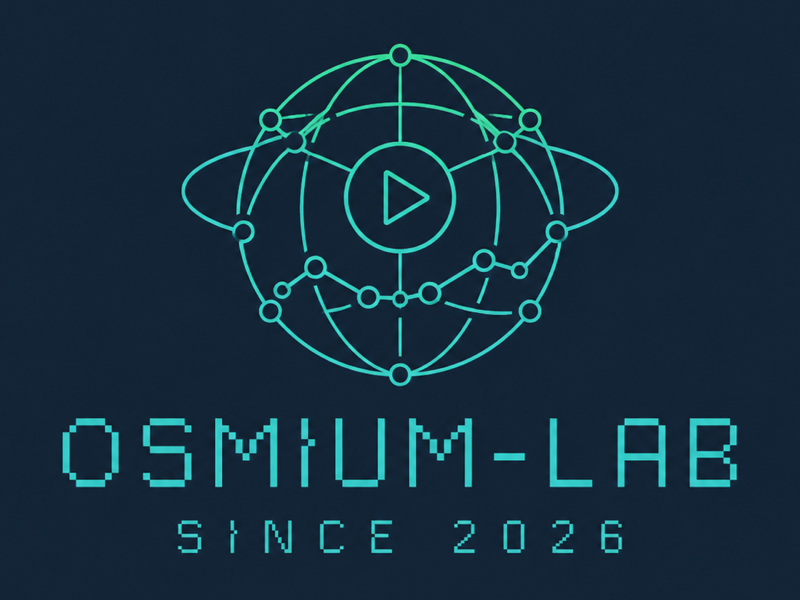

# Osmium Lab

<p align="center">
  
</p>

<p align="center">台灣市場歷史行情回播與策略回測平台</p>

Osmium Lab 是 Rust 實作的 market replay 與 backtesting platform。唯一資料源是 marketdata
資料表（`/srv/md/v1`，parquet）：osmium 直接讀取交易所逐筆成交與五檔揭示，依交易所序號
deterministic replay，再串接編譯期 Rust strategy、成交模擬、帳務與 run artifacts。

> 狀態：全市場撮合模擬改建中（[ADR-0008](docs/design/decisions/0008-full-market-matching-simulation.md)）。
> 行情解碼（`osmium-md`）、跨 feed 回放時間線（`osmium-replay`）、book 交易模式（`osmium-book`）
> 與撮合（`osmium-matching`）已完成；帳務、策略介面與 CLI 尚未完成，進度見
> [架構的遷移狀態](docs/design/architecture.md#遷移狀態)。

## 設計原則

- **正確性優先**：只使用來源能證明的 evidence；`NoObservation`、`Unknown`、`Known` 分開，
  不猜測缺值、不重建 queue、不偷看未來。
- **速度優先**：marketdata 已是正規化、排序好的欄式資料，osmium 不再維護第二份 cache；
  熱路徑不配置 heap、不做 per-event hashing。
- **可重現**：run 記錄讀到的每個 marketdata 檔案的 manifest identity；相同資料、版本與設定
  產生相同結果。

## 文件

從[文件地圖](docs/README.md)開始。

## 開發

```sh
cargo test --workspace
```

完整 gate 見[驗證](docs/development/validation.md)。
